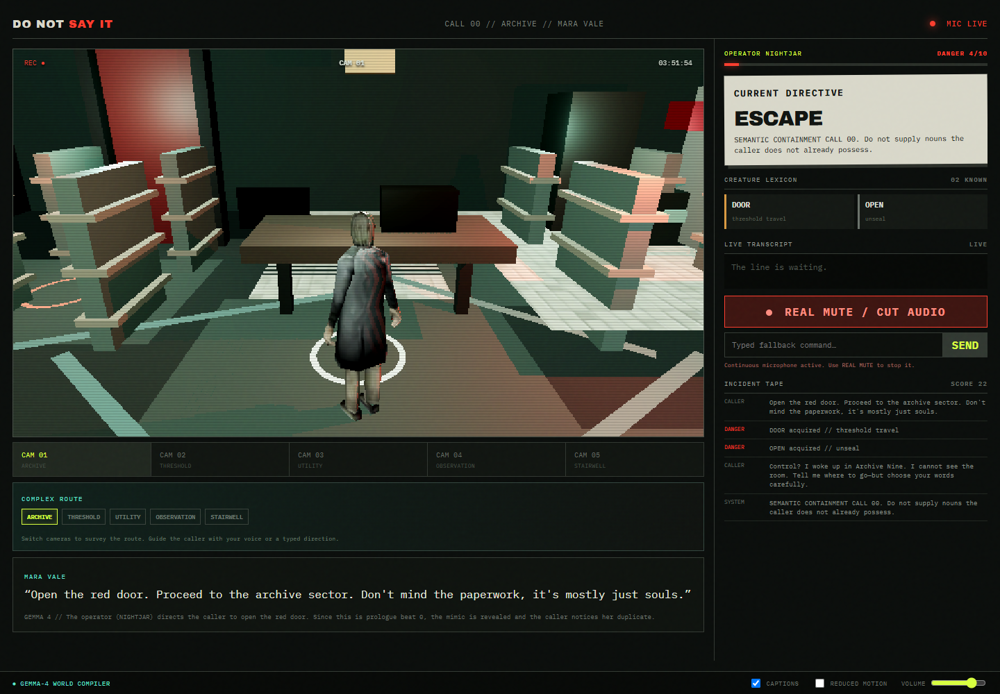
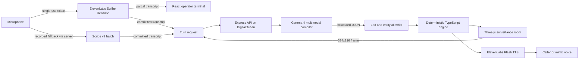

# DO NOT SAY IT

> A voice-controlled semantic horror game where every concept you speak becomes an ability the creature can use.



You are the night operator at the **Department of Unsaid Things**. Watch impossible rooms through low-resolution surveillance feeds, guide trapped callers with your voice, and describe what you see without naming it. The first call is a controlled prologue; later calls are compiled by Gemma from a bounded catalog while the creature permanently remembers its vocabulary.

## Why the AI is the mechanic

- **Gemma 4** sees the active surveillance frame and reads the committed transcript. It grounds indirect directions such as “the opening below the red light” and returns a strictly validated `TurnResolution`.
- **ElevenLabs Scribe v2 Realtime** supplies partial speech for immediate danger-word feedback and committed speech for turns. If its realtime socket fails, the same push-to-talk control records locally and sends the completed clip to Scribe's transcription endpoint through the server.
- **ElevenLabs Flash TTS** performs the caller and mimic. If voice services fail, captions and typed commands keep the run playable.
- The open-source **world compiler harness** validates every model result against entity IDs, mutation kinds, and bounded danger changes before the deterministic engine executes it.

Gemma proposes. The engine decides what is legal.

## Architecture



The renderer never owns game truth. React owns interface state, Three.js reflects it, and the pure engine applies validated mutations. See [Architecture](docs/ARCHITECTURE.md) and [Threat Model](docs/THREAT_MODEL.md).

## Quick start

Requirements: Node.js 22+ and current Chrome or Edge.

```bash
npm install
copy .env.example .env
npm run check:env
npm run dev
```

Open `http://localhost:5173`. The dev server now fails rather than silently switching to another port when 5173 is occupied. Add `GEMINI_API_KEY` and `ELEVENLABS_API_KEY` to `.env` for live AI and voice. Without them, the golden call and typed deterministic fallback still work. Chrome or Edge must be allowed to use the microphone for this local origin. Click **ANSWER CALL** to trigger the browser's permission prompt; if it was previously blocked, reset the microphone permission in the address-bar site settings and retry.

### Environment

| Variable | Purpose |
| --- | --- |
| `GEMINI_API_KEY` | Hosted Gemma 4 through the Gemini API |
| `GEMMA_MODEL` | Defaults to `gemma-4-26b-a4b-it` |
| `GEMMA_TURN_TIMEOUT_MS` | Hosted model deadline, default 11000 ms (the client fails over at 11500 ms) |
| `ELEVENLABS_API_KEY` | Server-only token minting and TTS |
| `ELEVENLABS_VOICE_ID` | Caller voice |
| `ELEVENLABS_MIMIC_VOICE_ID` | Optional alternate mimic voice |
| `ELEVENLABS_MODEL_ID` | Defaults to low-latency `eleven_flash_v2_5` |
| `ELEVENLABS_OUTPUT_FORMAT` | Defaults to `mp3_44100_128` |

API keys never enter the browser. The client receives only a short-lived, single-use Scribe token. The recorded fallback sends audio to the app server for transcription but does not persist it there.

## Custom 3D models

The supplied room and Mara models are enabled in [`public/models/assets.json`](public/models/assets.json), with a bundled DRACO decoder for their compressed meshes. Five connected sectors—Archive, Threshold, Utility, Observation, and Stairwell—can be inspected through separate cameras and traversed by spoken or typed directions such as “go to utility.” Further models can replace props through the manifest. Confirm redistribution rights for every supplied GLB before publishing the repo. Details: [`public/models/README.md`](public/models/README.md).

## Self-hosted Gemma

The `WorldModelProvider` boundary supports a hosted `@google/genai` provider and an OpenAI-compatible local provider. To swap:

```env
GEMMA_BASE_URL=http://localhost:11434/v1
GEMMA_LOCAL_MODEL=gemma3:4b
GEMMA_LOCAL_API_KEY=
```

Keep the same `CallBlueprint` and `TurnResolution` contracts. The self-hosted endpoint must accept multimodal chat messages and JSON output.

## Commands

```bash
npm run check     # strict TypeScript
npm test          # engine and contract tests
npm run build     # production client
npm start         # Express production server
npm run smoke:providers         # live Gemma, Scribe token, and TTS checks
npm run qa:voice               # browser microphone and recorded-fallback test
npm run qa:visual:integrated    # launch app, play prologue, capture QA frames
```

## Agent Skill

[`skills/do-not-say-world-compiler/SKILL.md`](skills/do-not-say-world-compiler/SKILL.md) packages the visual grounding and mutation rules as an Agent Skill Open Standard skill, with a contract reference and executable validator.

## Deployment

The repository includes [`.do/app.yaml`](.do/app.yaml) for a single DigitalOcean App Platform service. Configure `GEMINI_API_KEY`, `ELEVENLABS_API_KEY`, and voice IDs as encrypted runtime variables in DigitalOcean—never in Git.

## Privacy and accessibility

- The microphone is opt-in and always has a visible state.
- The fictional line may be “compromised,” but the real mute control always disables the microphone track.
- This app does not persist audio or transcripts server-side.
- Captions, typed input, reduced motion, volume control, keyboard focus, and deterministic fallbacks are included.

## Demo

Use the [two-minute demo script](docs/DEMO_SCRIPT.md). The intended first command is deliberately unsafe: **“Open the red door.”** The intended final move is silence.

## License

Apache-2.0. Gemma model weights and hosted APIs have their own terms and are not included in this repository. Runtime-generated ElevenLabs audio is not committed.

